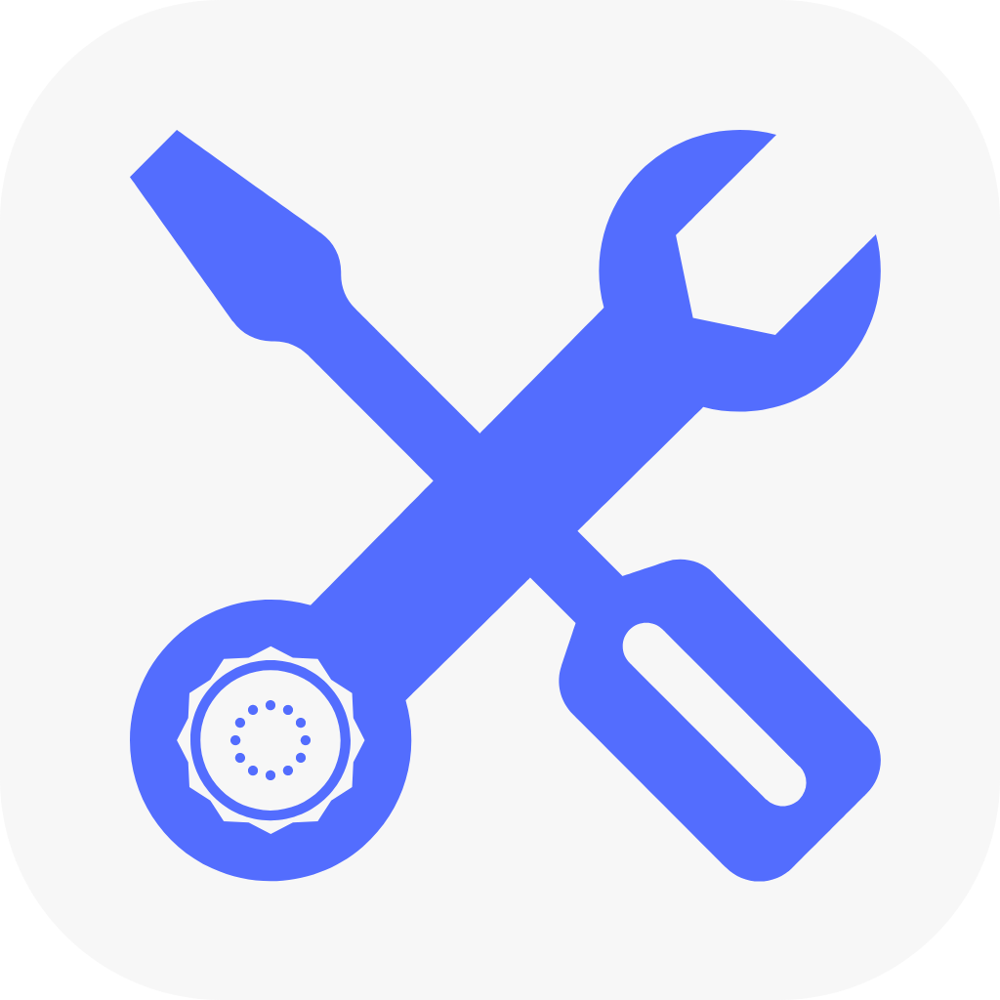

# **Student Tool Box**
**Everything you need, all in one!**

## **Table of Content:**
- [Introduction](#introduction)
- [Features](#features)
- [Production](#production)

### **Introduction**

**Student Tool Box** is a lightweight toolbox app that compiles all the useful tools and software students use in their day-to-day activities, into a single application. Its aim is to make those tools easily accessible in one place, reducing the need for installing numerous applications that handle different activities.

**Student Tool Box** is written in _Vite React_ and built with _Capacitor_ and _Android Studio_ to provide maximum efficiency and compatibility with all types of devices. It's made to support and utilize the best features your device can provide, maximizing the user experience.

Why download all those apps when you have **Student Tool Box**? : )

---

### **Features**
- **Document Scanner:** Scan your notes and compile then into a PDF with our **document scanner**.
- **Document Management:** Read and manage your documents like a pro. Supports reading, conversion and editing of documents _PDFs_, _DOCXs_, _PPT_ etc.
- **Offline Maps:** Navigate your way through _AFIT_ with the offline SVG map.
- **Fun and Games:** Done studying for the day? Indulge in education games like tictactoe, quizzes and jokes.
- **Dictionary:** A simple English dictionary for looking up words.
- **Calculator and Converter:** A scientific calculator with built in quantity conversion.
---

### **Production**
To work with the project, you'll need the following:
- Node and npm.
- Android Studio, Gradle and Android SDKs.
- A text editor, [Visual Studio Code](https://) is recommended.
- A web browser for previewing and monitoring changes, any browser will suffice.
- All the packages in [package.json](./package.json).

Here's a walkthrough:

### Node and Node Package Manager
Since the project is written in React.js, you'll need the Node Runtime Manager installed. If you don't already have it installed, you can install it with your terminal or download the setup from the [Official Node Website](https://).
```bash
# On Windows, using winget or choco:
choco install node
winget install node
# On Linux, using apt
sudo apt install node
# On Mac, using brew
brew install node
```
Node usually comes with _Node Package Manager_ installed.
Verify the installation in your terminal:
```bash
node -v
npm -v
```
### Android Studio
This is important if you plan on converting the build to an android application. You can install it from [The Official Android Studio Website](https://).

After installing, open Android Studio and install the necessary SDKs, including [Gradle](https://).

### Text Editor and Web Browser
You'll need a text editor to edit the code and a web browser to view changes while testing and previewing before build. **Visual Studio Code** is highly recommended for both tasks as it has its own _Integrated Terminal_ and _Integrated Browser_, but any text editor and web browser is alright. You can get VS Code from [The Official Visual Studio Code Website](https://).

### NPM packages
Once everything is installed, we can begin production by installing the dependencies necessary for running the app. The app will not run without these dependencies.

All required dependencies are already listed in the [package.json](./package.json), just run this in your terminal to install them:
```bash
npm install
```
Now everything is set, we can begin production.

### Testing and Previewing
For testing and previewing the app before build, run this in your terminal:
```bash
npm run dev
```
The server will be opened at [http://localhost:5173/](http://localhost:5173/) and will reload on any change.

### Build
To build an android app, you'll need to first compile your code. Run this in you terminal:
```bash
npm run build
```
a [/dist](./dist/) folder will be created in your root directory with you codes.

Next, we need to setup _Capacitor_ for conversion. Run the following:
```bash
npx cap init
npx cap add android
npx cap sync
```

This will add an [/android](./android/) folder to your root directory, copy the files from [/dist](./dist/) to the [/public](./android/app/src/main/assets/public/) folder in [/android](./android/) and install necessary capacitor plugins.

> _If you still intend to modify the code for testing, run this short code to run the dev, build the app and copy your updated files on each run:_
> ```bash
> npm run dev; npm run build; npx cap copy
> ```

---

### **Notes**
- The app centers on the **Air Force Institute of Technology**, so some features like the _Offline Maps_ and _PDF Database_ will be school specific.
---
### **Credits**
This project was made and managed by [Halo Studios](https://), owned by **Aa Man**.

© All rights reserved, 2026. 

---
